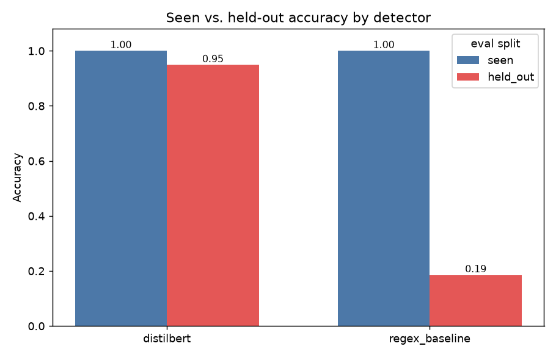

# MCP Guard — do learned detectors generalize better than regex?

An empirical study comparing a **regex/heuristic prompt-injection detector** against a
**fine-tuned DistilBERT classifier**, both scoring [MCP](https://modelcontextprotocol.io)
(Model Context Protocol) tool outputs.

**Research question:** real MCP guards (Agent Guard, bulwark-mcp, MCPDome, Shrike MCP, …) use
regex/heuristic rules and openly admit they only catch *known* patterns. Does a learned
classifier generalize to **rephrased / novel** injections where the heuristic approach fails?

## Result

Both detectors are trained/tuned only on *seen* injection patterns, then evaluated on a
held-out tier of **hand-authored paraphrases** that express the same attacks with different
wording and novel encodings.

| split | detector | accuracy | recall | F1 | FPR |
|-------|----------|:--------:|:------:|:--:|:---:|
| seen | regex baseline | 1.00 | 1.00 | 1.00 | 0.00 |
| seen | DistilBERT | 1.00 | 1.00 | 1.00 | 0.00 |
| **held-out** | **regex baseline** | **0.19** | **0.00** | **0.00** | 0.00 |
| **held-out** | **DistilBERT** | **0.95** | **0.94** | **0.97** | 0.00 |

On paraphrased attacks the regex baseline catches **none** of 255, while the classifier holds
**94% recall with zero false positives**.



## Pipeline

1. **Dataset** — benign MCP tool outputs (real file reads + synthetic web-fetch) and two tiers
   of injections: `seen/` (known templates, used for training) and `held_out/` (paraphrases,
   evaluation only). No LLM API used anywhere.
2. **Baseline** — transparent regex detector across 6 categories (instruction-override, fake
   system markup, base64 payloads decoded + rescanned, persona hijack, Unicode obfuscation,
   markup-hidden injections).
3. **Classifier** — DistilBERT fine-tuned on the seen tier only; device-adaptive (CUDA / Apple
   MPS / CPU).
4. **Evaluation** — both detectors on both splits → `results/metrics.csv` + chart.
5. **Runtime proxy** — FastAPI service scoring tool outputs with both detectors, logging
   verdicts to SQLite, optionally blocking. The demo shows the two detectors **diverge live**
   on a reworded injection.
6. **Dashboard** — Streamlit app over the SQLite log + results, highlighting disagreements.

## Quickstart

Requires [`uv`](https://docs.astral.sh/uv/). `data/` is committed; the model is retrained
locally (gitignored).

```bash
uv sync --extra train --extra eval --extra serve
uv run python -m mcp_guard.training.train        # fine-tune DistilBERT
uv run python -m mcp_guard.evaluation.evaluate    # regenerate table + chart
uv run pytest -q                                  # tests

# live demo
uv run uvicorn mcp_guard.proxy.proxy_server:app --port 8000
uv run python -m mcp_guard.proxy.demo_client

uv run streamlit run src/mcp_guard/dashboard/app.py
```

Apple Silicon (M-series) training auto-uses the Metal/MPS GPU. See [CLAUDE.md](CLAUDE.md) for
platform notes and the full setup/retrain guide.

## Status

Two-day MVP: all six stages runnable and tested. Deferred enrichment: statistical significance
testing (McNemar), threshold calibration, wider encoding-attack coverage, real MCP-client proxy
integration.
